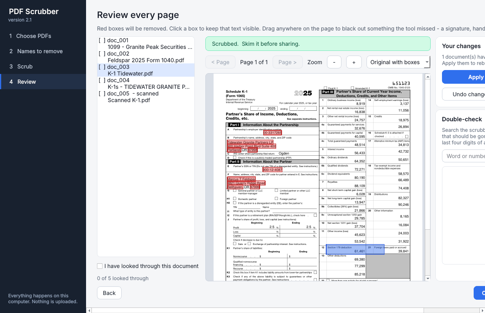
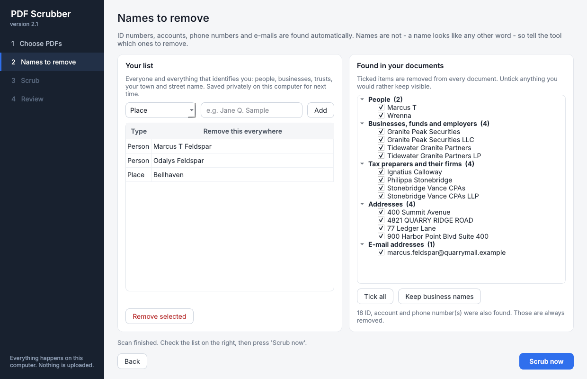

# PDF Scrubber

Black out personal details in tax PDFs — K-1s, 1040s, W-2s, 1099s, brokerage
statements — on your own computer, so the copies can be shared with an AI
assistant or an adviser for analysis.

Nothing is uploaded. Your original files are never changed.



*All screenshots use made-up people and numbers.*

## What it does

| | |
|---|---|
| **Removed** | SSNs and EINs, bank routing and account numbers, phone numbers, e-mail addresses, street addresses, city and ZIP, dates of birth, IP PINs, the name / address / ID boxes on IRS forms, and every name you list |
| **Also removed** | Hidden data inside the PDF: metadata, bookmarks, attachments, form-field values, comments, hidden text, and images on text pages (logos, signatures, barcodes) |
| **Kept** | Dollar amounts, line numbers, dates, state codes, occupations, security identifiers (CUSIPs) |
| **Replaced with tags** | Each removed item becomes a tag such as `[ID-1]` or `[NAME-2]`. The same person or number gets the same tag in every document, so the set can still be read together |
| **Renamed** | Outputs are `doc_001`, `doc_002`, … because file names usually contain a surname or fund name |

## Read this first

This is pattern matching with a person checking the result. It is not a guarantee.

- **It cannot recognise a name it was never told.** Step 2 asks for your names and shows the ones it found.
- **Scanned pages are the weak spot.** Handwriting, stamps, signatures and faint print can be missed. The review screen marks scanned pages; look at those closely.
- **Review before you share.** Step 4 shows every page with its boxes. Click a box to keep that text, drag to black out more.
- Not legal or tax advice. Use at your own risk.

## Install

### Windows

Download `PDF-Scrubber-…-windows-setup.exe` from the [Releases](../../releases)
page and run it. Everything it needs is inside, including the reader for
scanned pages. It installs for your user account only, so no administrator
password is needed.

Windows may show a "Windows protected your PC" notice because the installer is
not code-signed. Choose **More info**, then **Run anyway**.

There is also a portable `.zip` on the same page: unzip it anywhere and run
`PDF Scrubber.exe`.

### macOS and Linux (or Windows from source)

1. Install Python 3.10 or newer.
2. Install Tesseract if any of your PDFs are scans: `brew install tesseract` or `sudo apt install tesseract-ocr`.
3. Download this repository, then:

```bash
python3 -m pip install -r requirements.txt
```

```bash
python3 scrubber_gui.py
```

On Windows from source, double-click `run_scrubber.bat` instead; it offers to
install the two Python packages on first run.

## The four steps

| | |
|---|---|
| **1. Choose PDFs** | Drop a folder or files. Duplicate downloads and locked files are flagged. Pick where the copies go and add any passwords. |
| **2. Names to remove** | Type the people, businesses and places that identify you. Press **Scan** and the tool lists the names, businesses and addresses it found in the forms; untick any you would rather keep visible. |
| **3. Scrub** | A progress bar per document and per page, with a Cancel button. Each document gets a plain-language result and a next step. |
| **4. Review** | Every page with its boxes. Click a red box to keep that text. Drag to black out anything missed. Search the results for a surname or the last four digits of an SSN. |



Text PDFs take a second or two each. Scanned pages take around half a minute
per page.

### Adding files later

Scrub more files into the same results folder and they continue the numbering
and use the same tags, so the whole set still reads together. Tick **Start
over** in step 1 to begin again.

### When a document is held back

The tool saves nothing it cannot verify. A held-back document shows why and
what to do; most often the fix is the **Flatten and scrub again** button, which
rebuilds every page as a picture.

## If something goes wrong

- **A document is held back.** Open step 4, select it, and follow the suggestion shown above the page.
- **A scrubbed copy will not save.** It is probably open in a PDF reader, which locks it on Windows. Close it and scrub again.
- **Scanned pages are left out.** The scan reader (Tesseract) is missing. The Windows installer includes it; from source, install it as described above.
- **Anything else.** Errors are shown on screen and written to `error.log` in the private folder below. When reporting a problem, include that file's last entry and the version number from the top-left of the window. It can contain file names, so read it first, and never attach real documents.

## Your private files

The names list, a list of which original became which `doc_` number, and the
memory that keeps tags stable are stored in a private folder, never in the
results folder:

| System | Folder |
|---|---|
| Windows | `%LOCALAPPDATA%\PDF Scrubber` |
| macOS | `~/Library/Application Support/PDF Scrubber` |
| Linux | `~/.local/share/pdf-scrubber` |

These contain personal details. Delete the folder to make the tool forget everything.

## How it protects you

- Every output is re-opened and re-checked before it is saved. A file that still
  trips a detector, or still holds a removed value anywhere in its raw data, is
  not written at all.
- Scanned pages are read, blacked out on the image itself, and read again until
  nothing more is found. Without Tesseract they are left out, not passed through.
- Anything found in one document is removed from all the others too.

## Command line and text menu

The same engine runs without the window, for scripting or over SSH:

```bash
python3 scrub_pdfs.py ~/taxes -o ~/taxes_scrubbed --terms pii_terms.txt
```

```bash
python3 scrub_pdfs.py
```

The second form opens a text menu. See `pii_terms.example.txt` for the names-list
format and `python3 scrub_pdfs.py --help` for every option, including
`--password`, `--keep-entities`, `--rasterize` (flatten every page) and `--fresh`.

## Tests

```bash
python3 -m pip install -r requirements-dev.txt
```

```bash
python3 -m pytest tests
```

The suite builds made-up documents in several layouts — IRS forms, tax-software
printouts, a fund's K-1 package, a brokerage 1099, a state return, and scans of
them — scrubs them, and checks that nothing personal can be found in the text,
the raw file data, or (by reading the rendered pages back with OCR) the picture,
and that every dollar amount survived. There is one regression test for each
bug found on real documents. Scan tests need Tesseract and take a few minutes.

Never add real documents to the tests or to an issue report.

## Building the Windows download

Pushing a tag such as `v2.0` runs `.github/workflows/release.yml`, which runs
the tests on Windows, builds the app with PyInstaller (bundling Tesseract),
checks that the built app starts and can read a scan, and attaches an installer
and a portable zip to a GitHub release. To build by hand on Windows:

```bash
python -m PyInstaller packaging/pdf_scrubber.spec --noconfirm
```

## Known limits

- Layouts are matched from IRS wording. Tax-software printouts, fund packages,
  brokerage statements and state returns are covered by made-up test documents,
  not by a survey of real ones; expect to add names to your list and to use the
  review screen.
- Handwriting, signatures drawn as line art, and barcodes inside scanned pages
  are not detected. Black them out by hand in the review screen.
- A town name is removed where it appears in a full address. To remove it
  everywhere, add it to your list as a Place.
- On scanned pages, a business name you chose to keep may still be blacked out
  when it sits inside a name-and-address box.
- U.S. federal forms and English only.
